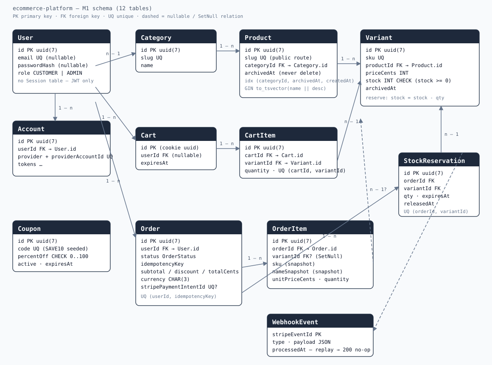

# ecommerce-platform

A storefront whose differentiator is **money correctness**: totals are recomputed on the server from `Variant.priceCents`, one order exists per checkout attempt even under concurrency, stock is reserved rather than leaked, Stripe webhooks are idempotent and order-agnostic, and a reconciliation job settles the webhook that never arrives.

**Status:** M1 — schema + deterministic seed. No UI yet.

## Stack

Next.js 15 (App Router, RSC) · TypeScript strict · PostgreSQL 16 · Prisma 6 · Auth.js v5 (JWT sessions) · Stripe test mode · Vitest · Playwright (from M4).

## Data model

Twelve tables. Eight carry the correctness claims — `User`, `Order`, `Variant`, `OrderItem`, `StockReservation`, `Cart`, `CartItem`, `WebhookEvent` — and `Product`, `Category`, `Coupon` plus the single Auth.js adapter table `Account` complete the model.



The diagram is [`docs/erd.svg`](docs/erd.svg). Constraints Prisma cannot express live in the initial migration:

- `CHECK ("stock" >= 0)` on `Variant`
- `CHECK ("percentOff" BETWEEN 0 AND 100)` on `Coupon`
- a GIN index over `to_tsvector('english', name || ' ' || description)` on `Product`

Index choices and real `EXPLAIN ANALYZE` output from this machine: [`docs/WHY-THIS-INDEX.md`](docs/WHY-THIS-INDEX.md).

## Local setup

Requires Node 22 and a local PostgreSQL 16 cluster on port 5433 with trust auth (native install, not Docker).

```bash
cp .env.example .env          # .env is never committed
npm install
npx prisma migrate deploy
npx prisma db seed -- --seed 42
npm run dev
```

`DATABASE_URL` points at `shop_dev`; `TEST_DATABASE_URL` points at `shop_test` and is used only by integration tests and migrate-deploy checks.

`prisma.config.ts` loads `.env` for the Prisma CLI (the CLI no longer does this automatically once a config file exists). If `.env` has not been created yet, it falls back to the local trust-auth URL from `.env.example`, so `npx prisma migrate deploy` works on a fresh checkout.

The seed is deterministic: it truncates and reseeds 40 products (2–3 variants each), 5 categories and one coupon (`SAVE10`). Every id is derived from the seed value and a fixed salt, so two runs with `--seed 42` produce the same ids, counts and SKU set.

## Scripts

| Script | Does |
|---|---|
| `npm run dev` | Next dev server on port 3000 |
| `npm run build` / `start` | production build / serve |
| `npm run lint` | ESLint (flat config, TypeScript strict) |
| `npm run typecheck` | `tsc --noEmit` |
| `npm run test` | Vitest |
| `npm run db:migrate` | `prisma migrate dev` |
| `npm run db:deploy` | `prisma migrate deploy` |
| `npm run db:seed` | `prisma db seed -- --seed 42` |
| `npm run db:drift` | `prisma migrate diff … --exit-code` against the live database |
| `npm run verify` | the M1 gate (below) |

## Verification

For M1, `npm run verify` is:

```bash
eslint && tsc --noEmit && vitest run && prisma migrate diff \
  --from-schema-datasource prisma/schema.prisma \
  --to-schema-datamodel prisma/schema.prisma --exit-code
```

The drift step needs `DATABASE_URL` (from your local `.env`) and must exit 0.

**Playwright is intentionally not part of `verify` at M1.** It is added at M4, when the first E2E tests exist; running it now would fail on an empty `tests/` directory. The full target is documented in the plan: `eslint && tsc --noEmit && vitest run --coverage && prisma migrate diff --exit-code && playwright test`.

## Invariants

Recorded in `CLAUDE.md` and enforced in code as they are implemented; the schema encodes:

1. Money is integer cents everywhere; no float arithmetic, no client-trusted price.
2. `OrderItem` snapshots `sku`, `nameSnapshot`, `unitPriceCents`; history never changes when a product changes.
3. One order per `(userId, idempotencyKey)` — the unique index is the arbiter, and a duplicate returns the existing order.
4. Stock never goes negative — `CHECK (stock >= 0)` is the database backstop; the reservation row is written in the same transaction.
5. Webhook replay is a 200 no-op via `WebhookEvent.stripeEventId`.
6. Amount mismatch becomes `REFUND_REQUIRED`, never `PAID`.
7. Admin "delete" sets `archivedAt`; nothing cascades away order history (`OrderItem.variantId` is `SetNull`).
